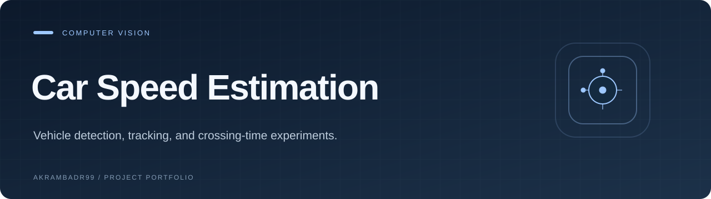

  

<strong>Vehicle detection, tracking, and crossing-time experiments.</strong>

<a href="#overview">Overview</a> · <a href="#explore">Explore</a> · <a href="#getting-started">Getting started</a>

<code>Python</code> · <code>OpenCV</code> · <code>YOLOv8</code>

## Overview

A Python computer-vision experiment that detects cars with YOLOv8, tracks their centers, and counts vehicles crossing two reference lines.

## Explore

- Car detection and bounding-box overlays
- Tracked vehicle identifiers
- Two-line directional counting
- Experimental speed labels from elapsed time

## Getting started

Install Python and the imported dependencies (`opencv-python`, `pandas`, `numpy`, and `ultralytics`). The repository does not pin a tested environment. Supply a local video and the `yolov8s.pt` weights, then update the video and `coco.txt` paths in `main.py` before running `python main.py`.

## Project notes

The scripts contain machine-specific paths. Video and model weights are not included. Speed uses wall-clock processing time and an assumed 10 m separation, so it is an experiment rather than a calibrated traffic measurement system. `speed.py` also uses an older Ultralytics boxes API.

---

<a href="https://github.com/Akrambadr99?tab=repositories">Explore the portfolio</a>

